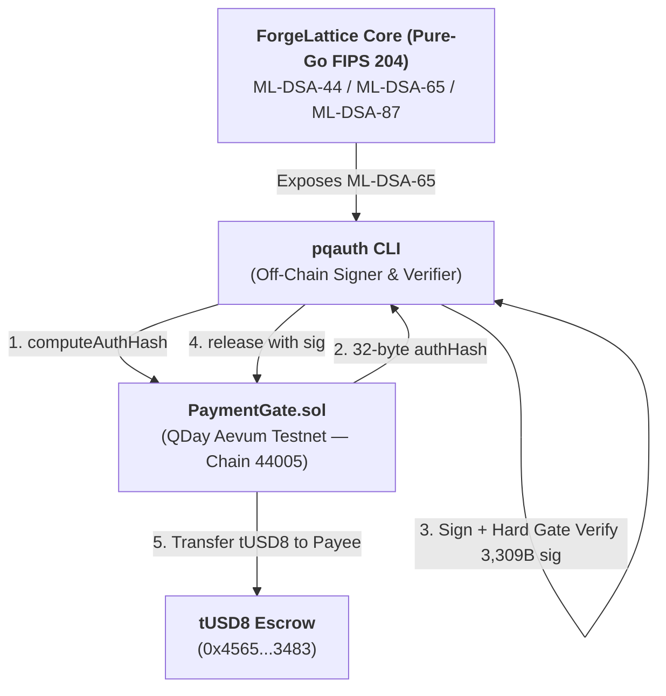

# ForgeLattice PQAuth — Post-Quantum tUSD8 Payment Gate on QDay Aevum

Off-chain **ML-DSA-65 (FIPS 204)** authorization powered by [ForgeLattice](https://github.com/Deeptiman/forgelattice), paired with deterministic on-chain **tUSD8** escrow settlement on the **QDay Aevum Testnet**.

[](https://github.com/Deeptiman/forgelattice-pqauth/actions)
[](https://explorer-test.qday.info/)
[](https://explorer-test.qday.info/address/0x6E9B3D34f4273e880AAaE5eE4b51850643227B8F)
[](https://github.com/Deeptiman/forgelattice)

> **Live Explorer & On-Chain Proof:** Inspect the deployed [`PaymentGate.sol`](https://explorer-test.qday.info/address/0x6E9B3D34f4273e880AAaE5eE4b51850643227B8F) and verified `tUSD8` settlement transaction [`0xf794...aded`](https://explorer-test.qday.info/tx/0xf794b7e1dbb06762145633815a32a277883bf67790c4cc47bd1de7ea67c2aded) directly on the **[QDay Aevum Block Explorer](https://explorer-test.qday.info/)**.

## Overview

Quantum computers threaten elliptic-curve signatures (`ECDSA`) used across standard EVM accounts. **ForgeLattice PQAuth** secures stablecoin disbursements on **QDay Aevum** using NIST-standardized **ML-DSA-65 (FIPS 204)** lattice cryptography:

1. **Off-Chain PQC Authorization (`pqauth` Go CLI):**
   - Generates deterministic or CSPRNG-seeded FIPS 204 `ML-DSA-65` keypairs (`1,952`-byte public key, `4,032`-byte private key).
   - Signs contract-bound payment digests (`3,309`-byte detached signatures) and enforces strict cryptographic verification as a zero-gas pre-broadcast gate.
2. **On-Chain Escrow & Settlement (`PaymentGate.sol`):**
   - Commits to the signer's `1,952`-byte ML-DSA-65 public key and its `keccak256` digest at deployment.
   - Computes `authHash` on-chain bound to domain separator, `chainId`, contract address, public key hash, `payee`, `amount`, and `nonce`.
   - Enforces exact FIPS 204 byte-length invariants, prevents replay attacks (`used[authHash]`), releases escrowed `tUSD8`, and emits `keccak256(signature)` for auditability.
   - *Upgrade-ready:* Designed so QDay's native ML-DSA-65 precompile can be plugged directly into `release()` once enabled on mainnet without altering key formats or CLI workflows.

---

## Why ForgeLattice?

Standard EVM accounts and stablecoin rails rely on elliptic-curve signatures (`ECDSA` over `secp256k1`), which are vulnerable to Shor's algorithm on cryptographically relevant quantum computers. Meanwhile, executing full lattice polynomial verification directly inside the EVM is prohibitively expensive without dedicated precompiles.

**[ForgeLattice](https://github.com/Deeptiman/forgelattice)** bridges this gap by serving as the **core post-quantum cryptographic engine** for decentralized payments:
- **Pure-Go, Zero-CGO Lattice Cryptography:** Built cleanly in Go without C bindings, making post-quantum key generation, signing, and verification portable across wallets, relayers, backend payment processors, and automated CI pipelines.
- **Full NIST FIPS 204 Parameter Support:** Supports `ML-DSA-44` (Category 2), `ML-DSA-65` (Category 3 — default), and `ML-DSA-87` (Category 5) with strict byte-level adherence to FIPS 204 public key (`1,952B`), secret key (`4,032B`), and detached signature (`3,309B`) encodings.
- **Zero-Gas Cryptographic Firewall:** Acts as a hard pre-broadcast verification gate (`pqauth verify`) in front of `PaymentGate.sol`, rejecting mutated or forged lattice signatures off-chain before a single wei of `tQDAY` gas is spent.
- **Seamless Precompile Upgrade Path:** Because ForgeLattice produces canonical NIST FIPS 204 public keys and signatures, `PaymentGate.sol` can swap its authorization check directly to QDay's native ML-DSA precompile once activated on mainnet—with zero changes to keys, signers, or off-chain payment flows.

---

## System Architecture



## Live QDay Aevum Testnet Deployment

- **Network:** QDay Aevum Testnet (`Chain ID: 44005`, RPC: `https://rpc-test.qday.info`)
- **tUSD8 Token:** [`0x456569838f1d43009A91ebA4263147Afd7233483`](https://explorer-test.qday.info/address/0x456569838f1d43009A91ebA4263147Afd7233483) (ERC-20, 6 decimals — `100` base units = `0.000100 tUSD8`)
- **PaymentGate Contract:** [`0x6E9B3D34f4273e880AAaE5eE4b51850643227B8F`](https://explorer-test.qday.info/address/0x6E9B3D34f4273e880AAaE5eE4b51850643227B8F)
- **Contract Deployment Tx:** [`0x0e5d1fc0f55723733e2c8ce185b466b60a1814947d8bb8923e26c0adfab6ea09`](https://explorer-test.qday.info/tx/0x0e5d1fc0f55723733e2c8ce185b466b60a1814947d8bb8923e26c0adfab6ea09)
- **Escrow Funding Tx (`100` tUSD8):** [`0x4e6f54393e68f51770d00ab13a0a38d19d4d9fdd04e995c1b07397315948ee3e`](https://explorer-test.qday.info/tx/0x4e6f54393e68f51770d00ab13a0a38d19d4d9fdd04e995c1b07397315948ee3e)
- **Verified Settlement Tx (`release`):** [`0xf794b7e1dbb06762145633815a32a277883bf67790c4cc47bd1de7ea67c2aded`](https://explorer-test.qday.info/tx/0xf794b7e1dbb06762145633815a32a277883bf67790c4cc47bd1de7ea67c2aded)

## Project Structure

```text
forgelattice-pqauth/
├── .github/
│   └── workflows/
│       └── ci.yml            # GitHub Actions CI: ML-DSA-65 CLI & Foundry tests
├── cmd/
│   └── pqauth.go             # Cobra CLI commands: keygen, sign, verify
├── contracts/
│   ├── foundry.toml          # Foundry config targeting Shanghai EVM
│   ├── scripts/
│   │   ├── deploy.sh         # Standalone deployment helper
│   │   └── settle.sh         # Standalone sign + verify + release helper
│   ├── src/
│   │   └── PaymentGate.sol   # Post-quantum tUSD8 escrow & settlement contract
│   └── test/
│       └── PaymentGate.t.sol # Foundry unit tests for access, sizing & replay guards
├── main.go                   # CLI entrypoint
├── Makefile                  # Color-coded, self-bootstrapping automation
└── README.md
```

## Quickstart

### Prerequisites

- **Go** `1.21+`
- **Foundry** (`forge`, `cast`)
- **`jq`** & **`openssl`**
- Funded QDay Aevum Testnet wallet (`tQDAY` for gas + `tUSD8` for escrow)

### Option 1: One-Command End-to-End Demo (Recommended)

Run the entire workflow in a single command. On first run, `make demo` automatically initializes `.env` (prompting once for `SETTLER_PK` with masked input), compiles the Go CLI and Solidity contract, generates an `ML-DSA-65` keypair, deploys `PaymentGate.sol`, funds `tUSD8` escrow, tests off-chain tamper rejection, settles on-chain, and verifies replay protection:

```bash
make demo
```

### Option 2: Step-by-Step Execution

1. **Build CLI & Smart Contract:**
   ```bash
   make build
   ```

2. **Run Foundry Smart Contract Unit Tests:**
   ```bash
   make test
   ```

3. **Generate FIPS 204 ML-DSA-65 Keypair:**
   ```bash
   make keygen
   # Outputs keypair.json (PK: 1952B, SK: 4032B)
   ```

4. **Deploy `PaymentGate.sol` to QDay Aevum Testnet:**
   ```bash
   make deploy
   # Add the deployed contract address to .env: PAYMENT_GATE="0x..."
   ```

5. **Fund Escrow with `tUSD8`:**
   ```bash
   make fund
   ```

6. **Sign On-Chain `authHash` Off-Chain:**
   ```bash
   make sign
   # Outputs sig.json (3309B signature)
   ```

7. **Verify Off-Chain & Settle On-Chain:**
   ```bash
   make settle
   make status
   ```

8. **Run Adversarial Security Checks:**
   ```bash
   make tamper-test   # Flips 1 byte in sig.json -> blocked off-chain (0 gas)
   make replay-test   # Re-submits settled nonce -> reverts on-chain (AuthAlreadyUsed)
   ```

## Makefile Reference

| Command | Description |
| :--- | :--- |
| `make help` | Show all available workflow commands |
| `make demo` | Run the full 8-stage end-to-end demo on QDay Aevum Testnet |
| `make build` | Compile the `pqauth` Go binary and `PaymentGate.sol` |
| `make test` | Run Foundry unit tests (`contracts/test/PaymentGate.t.sol`) |
| `make keygen` | Generate a fresh `ML-DSA-65` keypair into `keypair.json` |
| `make deploy` | Deploy `PaymentGate.sol` bound to the generated public key |
| `make fund` | Transfer `AMOUNT` of `tUSD8` base units into `PaymentGate` escrow |
| `make sign` | Query on-chain `computeAuthHash()` and sign into `sig.json` |
| `make verify` | Run off-chain `ML-DSA-65` verification against on-chain `authHash` |
| `make settle` | Enforce off-chain verification gate, then execute `PaymentGate.release()` |
| `make status` | Inspect escrow balance, payee balance, `authHash`, and replay lock |
| `make tamper-test` | Verify that a 1-byte signature mutation is rejected off-chain (`0` gas) |
| `make replay-test` | Verify that re-submitting a used nonce reverts with `AuthAlreadyUsed` |
| `make run-payment NONCE=2` | Execute a subsequent payment cycle on an existing `PAYMENT_GATE` |
| `make clean` | Remove compiled binaries and Foundry build cache |

## Security Invariants

- **Domain & Context Separation:** `authHash` binds `"FORGELATTICE_MLDSA65_PAYMENT_V1"`, `block.chainid` (`44005`), `address(this)`, `keccak256(dilithiumPublicKey)`, `payee`, `amount`, and `nonce`—preventing cross-chain, cross-contract, or parameter-substitution replays.
- **Exact FIPS 204 Sizing:** Both the constructor and `release()` enforce strict `1,952`-byte public keys and `3,309`-byte signatures.
- **Zero-Gas Malformed Rejection:** `make settle` requires `./pqauth verify` to exit `0` before broadcasting `cast send`, blocking invalid signatures without wasting gas.
- **Checks-Effects-Interactions-Events (CEIE):** `used[authHash]` is set to `true` and `Released` is emitted before invoking `tusd8.transfer(...)`.

## Automated Testing & CI Verification

Every push to `main` runs `.github/workflows/build.yaml` on GitHub Actions to verify:
1. **Cryptographic Round-Trip & Tamper Rejection:** Compiles `pqauth`, generates an `ML-DSA-65` keypair (`1,952B` PK / `4,032B` SK), signs a 32-byte digest (`3,309B` signature), verifies the authentic signature, and asserts that a 1-byte mutation fails verification.
2. **Foundry Contract Unit Tests (`make test`):** Validates constructor zero-address checks, public key and signature length guards, settler access control, `Released` event emission, `AuthAlreadyUsed` replay locks, and ERC-20 transfer failure handling.

## Assumptions, Limitations & Roadmap

- **Current Architecture Assumption:** Because QDay Aevum Testnet does not yet expose an EVM precompile for NIST FIPS 204 lattice verification, `PaymentGate.sol` pairs off-chain `ML-DSA-65` verification (enforced as a hard gate before transaction broadcast) with on-chain `settler` authorization, byte-length validation, and deterministic `authHash` replay protection.
- **Known Limitation:** Settlement currently relies on an authorized `settler` relay to submit verified signatures on-chain.
- **Mainnet Roadmap:**
   1. **Native QDay PQC Precompile Integration:** Plug QDay's native `ML-DSA-65` precompile directly into `PaymentGate.release()` for trustless, permissionless on-chain lattice verification using the exact same `1,952B` public keys and `3,309B` signatures.
   2. **ERC-4337 Account Abstraction & Gasless Paymasters:** Enable smart accounts to authorize `tUSD8` payments with gas sponsored in `tUSD8`.
   3. **Batch & Streaming Escrows:** Extend `authHash` commitments to Merkle batch payouts and time-vested merchant/payroll streams.